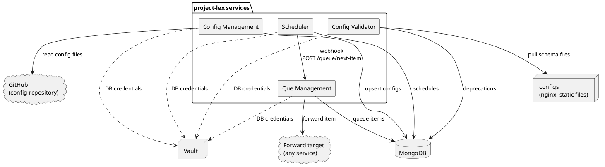
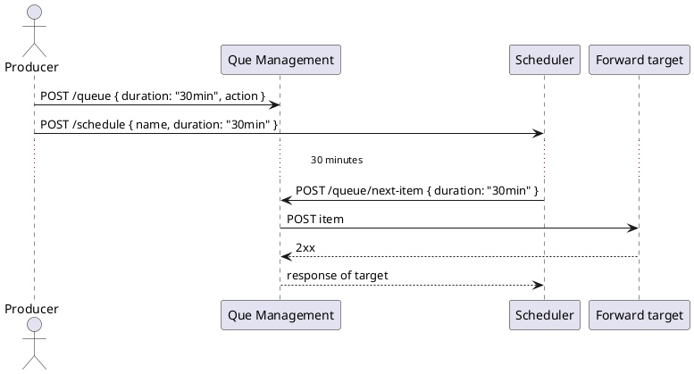
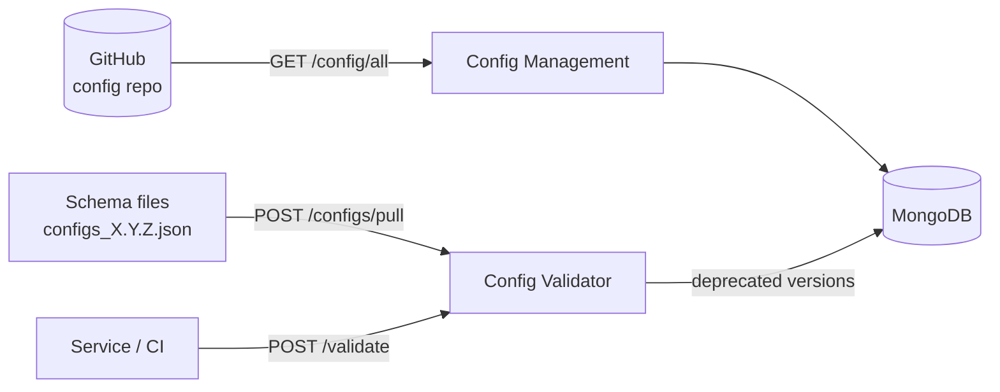
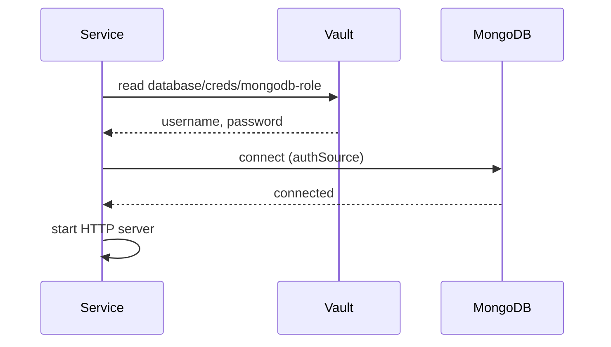

# Development information

## Overview services

We use multiple types of services written as micro services. These architechture solves multiple benefits:

1. separation of concern
2. faster development
3. flexibility over tools

So some services lean on one tool more heavy than others.:octicons-info-24:{ title="This is intended." }

Here you will find a list (might be inaccurate) of the services we use and their intended behavior.

| service           | short description                                                                                             | state               |
| ----------------- | ------------------------------------------------------------------------------------------------------------- | ------------------- |
| auth              | external authorization provider like keycloak                                                                 | :octicons-check-24: |
| config management | loads configs from github and saves them into our mongoDB                                                     | :octicons-check-24: |
| config validator  | validates service configurations against versioned JSON schemas. Schema versions can be marked as deprecated; | :octicons-check-24: |
| scheduler         | can run multiple ques to send requests periodically                                                           | :octicons-check-24: |
| que management    | holds items in a que and will be forwarded after request from scheduler                                       | :octicons-check-24: |
| token management  | issues, validates and revokes opaque API tokens (planned, not implemented yet)                                | :octicons-clock-24: |
|                   |                                                                                                               |                     |

### external services

Some services are _not_ maintained by the project-lex team. This is the true for services which include functions, but is not limited to:

- security
- mailing
- user credential management

Since we focus on openness we are transparent about these services.

- Auth (keycloak)
- secret management (vault)
- DNS

### internal services

All other services are developed and maintained by project-lex.

- [Config Management](./services/config-management.md)
- [Config Validator](./services/config-validator.md)
- [Scheduler](./services/scheduler.md)
- [Que Management](./services/que-management.md)
- [Token Management](./services/token-management.md)

## How the services work together

All internal services share the same infrastructure: **HashiCorp Vault** hands out MongoDB credentials, **MongoDB** stores the state. Each service is stateless apart from that and is reachable via HTTP.

| Service           | Reads from                | Writes to           | Calls                       | Language        |
| ----------------- | ------------------------- | ------------------- | --------------------------- | --------------- |
| config management | GitHub                    | MongoDB             |                             | TypeScript      |
| config validator  | config file host, MongoDB | MongoDB, local files|                             | TypeScript      |
| scheduler         | MongoDB                   | MongoDB             | webhook (`WEBHOOK_URL`)     | Go              |
| que management    | MongoDB                   | MongoDB             | forward target (`FORWARD_URL`) | TypeScript   |

### Typical flow: from schedule to action

A producer puts work into the queue, a schedule with the same duration later triggers its delivery.

!!! note
    The link from the scheduler to the queue is plain configuration (`WEBHOOK_URL` of the scheduler pointing at the queue). Nothing in the code couples the two services.

### Typical flow: configuration lifecycle

Config Management distributes the actual configuration of the services, while Config Validator checks such a configuration against the versioned schemas.

### Shared startup pattern

Every service follows the same startup order. A service that cannot get credentials or reach MongoDB does not start (Config Management is the exception: it connects lazily on the first request).

### Cross-cutting limitations

- No service authenticates its callers yet. They are meant to run inside a trusted network.
- Dynamic Vault credentials are fetched once per process and not renewed.
- The Dockerfiles install dev dependencies in the runtime image.
