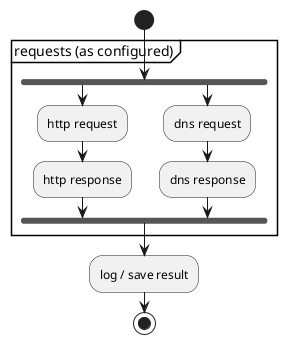
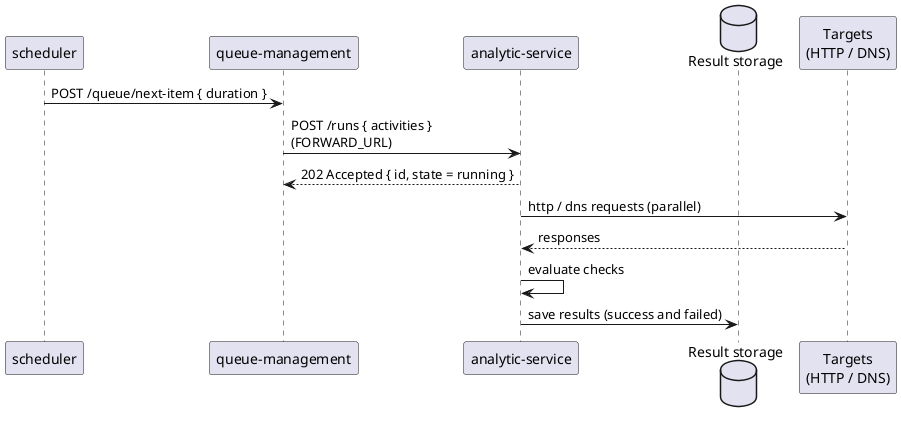
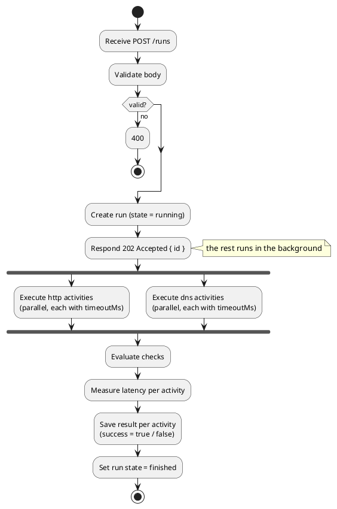
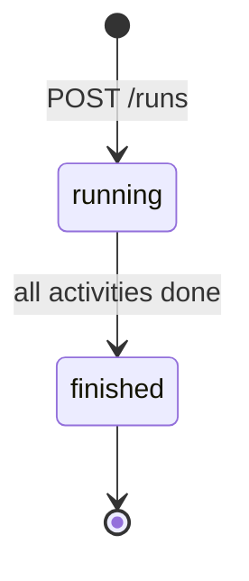
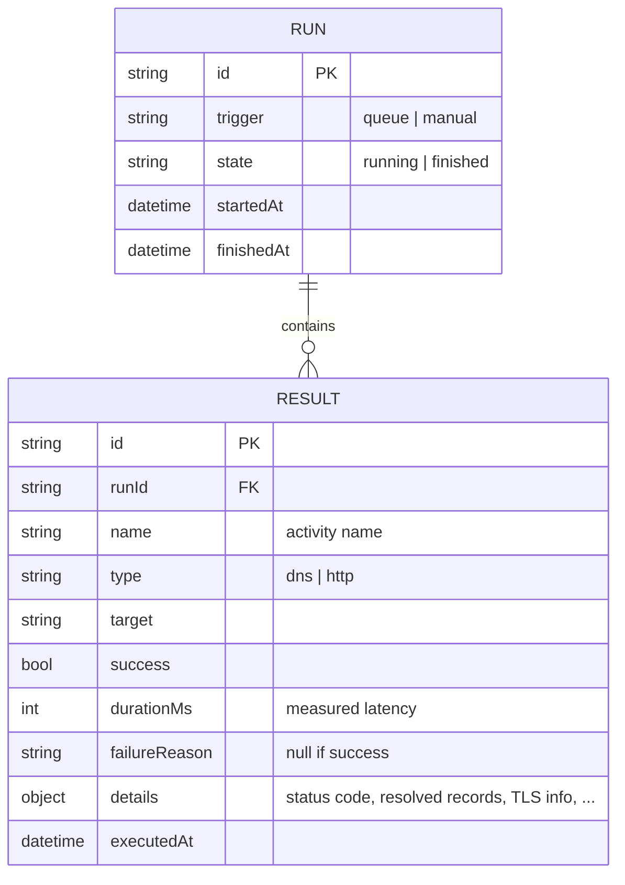

!!! note "Draft specification"
    There is no repository yet. This page describes the intended behaviour. Language, framework and storage are not fixed; open points are listed under [Open questions](#open-questions).

The analytic service measures **availability and latency** of configured targets. It executes the requests itself (HTTP and DNS), checks the responses against the expectations of the configuration and stores the result. For websites it is planned to additionally cover visitors, CTAs and goals in the future (see [Website analytics](#website-analytics-future)).

## Responsibilities

- Receive a list of _activities_ (targets + checks) via REST.
- Execute every activity itself: HTTP requests and DNS lookups, in parallel.
- Evaluate the response against the configured check and measure the response time.
- Answer a run request immediately with `202 Accepted` and execute the run in the background.
- Store the result of every activity, successful or failed. Failed activities are not retried.
- Provide endpoints to query results, start a run manually and read the details of a run.
- Read credentials (if a target needs them) from HashiCorp Vault.

Not in scope: scheduling ([scheduler](./scheduler.md)), ordering and forwarding of work ([queue management](./que-management.md)), validation of the configuration ([config validator](./config-validator.md)). The [token management](./token-management.md) is **not** involved.

## Flow overview

This service concentrates mostly on the _"requests (as configured)"_ so the real image would look like this:



## Place in the system

The targets are not stored in the analytic service. They arrive in the request body, in the JSON format shown below. Normally the request is sent by the queue management, which forwards the queue item to the analytic service when the scheduler fires.



A user or operator can start the same run by calling `POST /runs` directly and read the outcome afterwards with `GET /runs/{id}`.

!!! note "No retries"
    Queue management removes an item as soon as the forward target answered (see its [known limitations](./que-management.md#known-limitations)). The analytic service answers with `202` right away and never retries failed activities. A failed activity is only stored as a result.

## Activity configuration

The request body contains a list of activities. Each activity has a `name`, a `type` (`dns` or `http`), a `target`, a `timeoutMs` and a type-specific `check`.

```json
{
  "activities": [
    {
      "name": "check dns",
      "type": "dns",
      "target": "example.com",
      "timeoutMs": 5000,
      "check": {
        "recordType": "A",
        "expectedValue": "2.2.2.2",
        "nameserver": "1.1.1.1",
        "followCname": true
      }
    },
    {
      "name": "check Site",
      "type": "http",
      "target": "https://example.com",
      "timeoutMs": 5000,
      "check": {
        "method": "GET",
        "expectedStatusCodes": [200],
        "verifyTls": true,
        "responseValidation": {
          "contentType": "application/json",
          "jsonPath": "$.status",
          "expectedValue": "ok",
          "maxResponseTimeMs": 2000
        }
      }
    }
  ]
}
```

### Common fields

| Field       | Type   | Description                                         |
| ----------- | ------ | --------------------------------------------------- |
| `name`      | string | Label of the activity, used in results              |
| `type`      | string | `dns` or `http`                                     |
| `target`    | string | Host name (`dns`) or URL (`http`)                   |
| `timeoutMs` | int    | Hard limit for the whole activity                   |
| `check`     | object | Type-specific check, see below                      |

### `dns` check

| Field           | Description                                                   |
| --------------- | ------------------------------------------------------------- |
| `recordType`    | Record type to resolve, e.g. `A`, `AAAA`, `CNAME`, `MX`, `TXT` |
| `expectedValue` | Value that must be among the returned records                 |
| `nameserver`    | Resolver to ask; the system resolver if omitted               |
| `followCname`   | Follow CNAME chains before comparing                          |

### `http` check

| Field                | Description                                                   |
| -------------------- | ------------------------------------------------------------- |
| `method`             | HTTP method                                                   |
| `expectedStatusCodes`| List of accepted status codes                                 |
| `verifyTls`          | Verify the TLS certificate; a failure counts as failed        |
| `responseValidation` | Optional checks on the body, see below                        |

`responseValidation`:

| Field               | Description                                                        |
| ------------------- | ------------------------------------------------------------------ |
| `contentType`       | Expected `Content-Type`                                            |
| `jsonPath`          | JSONPath evaluated on the body (requires JSON)                     |
| `expectedValue`     | Expected value at `jsonPath`                                       |
| `maxResponseTimeMs` | Response time above this value fails the check even if the status matches |

An activity is **successful** only if all of its configured checks pass within `timeoutMs`. The reason for a failure (timeout, wrong status, TLS error, wrong value, NXDOMAIN, ...) is stored with the result.

## Execution of a run



Activities of one run are independent: a failing activity never stops the others.

## Results

Every activity produces one result record (with the run it belongs to), whether it succeeded or not. Failed activities are **not retried**; the failure and its reason are only stored and can be queried via the API.



### Data model (proposal)



## API

| Method | Path         | Description                                           | Success | Errors        |
| ------ | ------------ | ----------------------------------------------------- | ------- | ------------- |
| `POST` | `/runs`      | Start a run with the given activities. Used by queue management and for manual runs. Executes in the background | `202` | `400` |
| `GET`  | `/runs`      | Query results, filterable by name, type, target, success and time range | `200` | `400` |
| `GET`  | `/runs/{id}` | Details of one run, including all activity results    | `200`   | `404`         |
| `GET`  | `/health`    | Health check (storage, Vault)                         | `200`   | `503`         |

`POST /runs` takes the JSON from [Activity configuration](#activity-configuration) as body. This is exactly what is sent to the service, whether queue management forwards it or it is started manually.

Response of `POST /runs` (`202`, proposal):

```json
{ "id": "…", "state": "running" }
```

Response of `GET /runs/{id}` (proposal), available while `state` is `running` with the results that exist so far:

```json
{
  "id": "…",
  "state": "finished",
  "trigger": "queue",
  "summary": { "total": 2, "successful": 1, "failed": 1 },
  "results": [
    { "name": "check dns", "type": "dns", "success": true, "durationMs": 41 },
    { "name": "check Site", "type": "http", "success": false, "durationMs": 2310, "failureReason": "maxResponseTimeMs exceeded (2000)" }
  ]
}
```

## Website analytics (future)

For websites it is potentially planned to additionally record **visitors, CTAs and goals**. This is **not part of the current scope** and not specified. It will need a different data path than the active measurement above, because visitor data is not produced by requests of the service itself. How the data gets in (tracking script or import) and the privacy aspects have to be decided when this is picked up.

## Configuration

Names are a proposal and depend on the chosen stack.

| Variable             | Description                                                 |
| -------------------- | ----------------------------------------------------------- |
| `PORT`               | HTTP port                                                   |
| `STORAGE_URI`        | Connection to the result storage                            |
| `DEFAULT_TIMEOUT_MS` | Used if an activity has no `timeoutMs`                      |
| `VAULT_ADDR`         | Vault address                                               |
| `VAULT_TOKEN`        | Vault token                                                 |
| `VAULT_SECRET_PATH`  | Path of credentials, only if a target needs them            |

Credentials are read from Vault only when needed (for example for the storage or for authenticated targets).

## Open questions

- **Queue forwarding:** queue management currently forwards the whole queue item (with the payload in `action`). The analytic service expects the activities JSON as body, so either the forwarded item is mapped to that body or the service accepts the item format. To be checked when wiring the services.
- **Retention and aggregation** of results; alerting on failures.
- **Authentication** of the endpoints (none of the other services has it yet).
- **Language, framework and storage** (free to choose; Go + MongoDB would match the scheduler, TypeScript + MongoDB the queue management).
