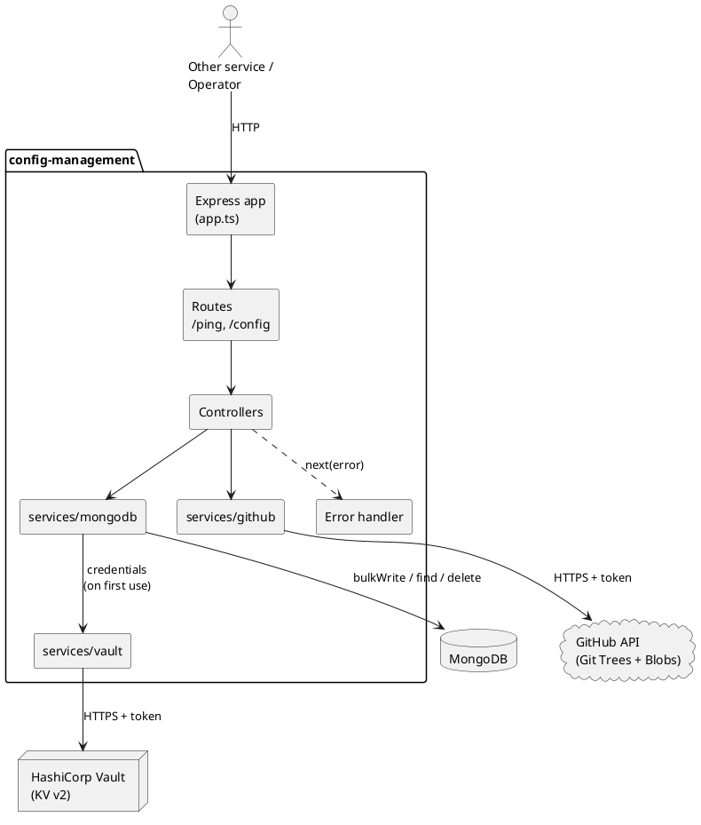
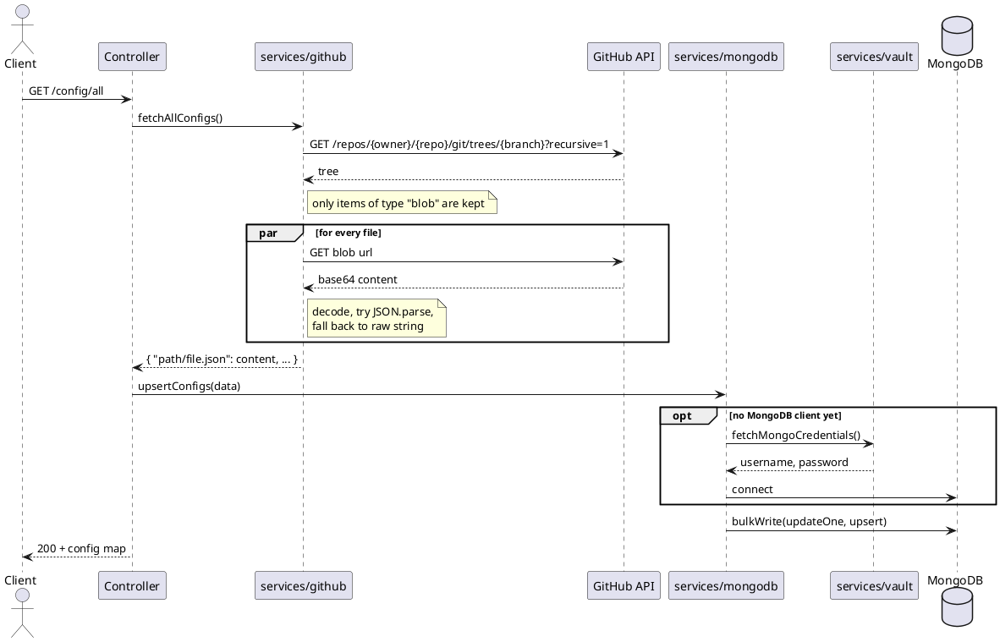
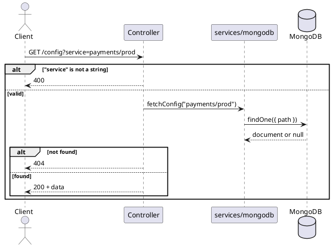
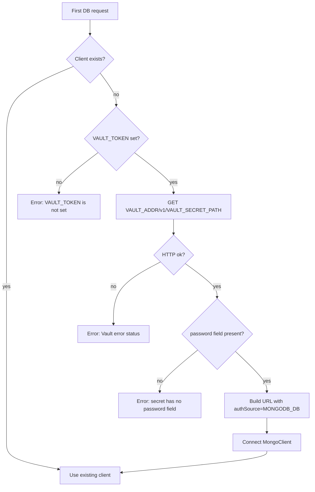
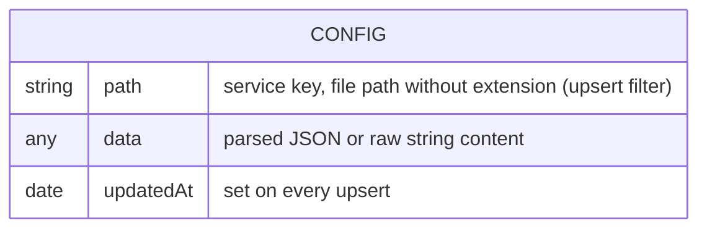
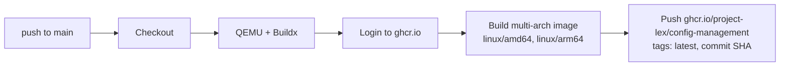

Config Management is a small TypeScript/Express service. It loads configuration files from a GitHub repository and stores them in MongoDB, so that other services can read their configuration from one central place.

Source: [project-lex/config-management](https://github.com/project-lex/config-management)

## Responsibilities

- Fetch every file of a configured GitHub repository/branch via the GitHub REST API.
- Persist the fetched files in MongoDB (upsert, one document per file).
- Serve a single config by its _service key_ from MongoDB.
- Delete one config or all configs from MongoDB.
- Get the MongoDB credentials from HashiCorp Vault at runtime, never from the environment.

!!! info "Service key"
    The service key is the file path inside the Git repository **without its file extension**.
    `payments/prod.json` becomes `payments/prod`.

## Architecture



### Code layout

| Path                              | Purpose                                                   |
| --------------------------------- | --------------------------------------------------------- |
| `src/main.ts`                     | Starts the HTTP server on `PORT`                          |
| `src/app.ts`                      | Express setup, JSON body parser, request logging, routing |
| `src/config/config.ts`            | Reads environment variables into a typed config object    |
| `src/routes/`                     | Route definitions (`ping`, `config`)                      |
| `src/controllers/`                | Request handlers, input validation, status codes          |
| `src/services/github.ts`          | Loads the repository tree and blobs from GitHub           |
| `src/services/mongodb.ts`         | MongoDB access (lazy singleton client)                    |
| `src/services/vault.ts`           | Reads the MongoDB credentials from Vault                  |
| `src/middlewares/errorHandler.ts` | Maps errors to a JSON response                            |

## API

| Method   | Path                    | Description                                                   | Success | Errors              |
| -------- | ----------------------- | ------------------------------------------------------------- | ------- | ------------------- |
| `GET`    | `/`                     | Returns `Hello World`                                         | `200`   |                     |
| `GET`    | `/ping`                 | Health check, returns `{"message":"Pong"}`                    | `200`   |                     |
| `GET`    | `/config/all`           | Syncs **all** files from GitHub into MongoDB and returns them | `200`   | `500`               |
| `GET`    | `/config?service=<key>` | Returns one config from MongoDB                               | `200`   | `400`, `404`, `500` |
| `DELETE` | `/config?service=<key>` | Deletes one config from MongoDB                               | `204`   | `400`, `404`, `500` |
| `DELETE` | `/config/all`           | Deletes all configs from MongoDB                              | `204`   | `500`               |

Errors are returned as JSON, e.g. `{"message": "..."}` (unhandled errors) or `{"error": "..."}` (validation / not found).

```bash
curl http://localhost:3000/ping
curl http://localhost:3000/config/all
curl "http://localhost:3000/config?service=payments/prod"
curl -X DELETE "http://localhost:3000/config?service=payments/prod"
curl -X DELETE http://localhost:3000/config/all
```

!!! warning "Not a mirror"
    `GET /config/all` is an **additive sync**: it upserts everything currently in GitHub, but it does not remove documents for files that were deleted in the repository. Use `DELETE /config/all` first if you need an exact copy.

## Flows

### Sync all configs from GitHub

`GET /config/all` always reads from GitHub (not from MongoDB), writes the result to MongoDB and returns the fetched object map.



### Read one config



### Credential handling

The MongoDB password is never part of the configuration. The MongoDB client is created lazily on the first database access and reused afterwards.



The secret is read from either `data.password` or `data.data.password` (KV v2), and an optional `username` the same way. If `VAULT_NAMESPACE` is set, it is sent as `X-Vault-Namespace`.

## Data model

Every config file is stored as one document in the collection `MONGODB_COLLECTION` of database `MONGODB_DB`.



Example:

```json
{
  "path": "payments/prod",
  "data": { "retries": 3, "timeoutMs": 2000 },
  "updatedAt": "2026-11-26T10:00:00.000Z"
}
```

!!! note
    Files whose content is not valid JSON (e.g. YAML or Markdown) are stored as a raw string in `data`. Two files with the same path but different extensions (`a.json`, `a.yaml`) map to the same key and overwrite each other.

## Configuration

Copy `.env.example` to `.env` for local development.

| Variable             | Required | Default                     | Description                                                  |
| -------------------- | :------: | --------------------------- | ------------------------------------------------------------ |
| `PORT`               |          | `3000`                      | HTTP port                                                    |
| `NODE_ENV`           |          | `development`               | Runtime environment                                          |
| `GIT_TOKEN`          |   yes    |                             | GitHub token with read access to repository contents         |
| `GIT_URL`            |   yes    |                             | Repository URL; owner and repo are parsed from it            |
| `GIT_BRANCH`         |   yes    | `main`                      | Branch to read                                               |
| `GITHUB_OWNER`       |          | from `GIT_URL`              | Overrides the parsed owner                                   |
| `GITHUB_REPO`        |          | from `GIT_URL`              | Overrides the parsed repository                              |
| `MONGODB_URI`        |   yes    | `mongodb://localhost:27017` | MongoDB connection URI, without password                     |
| `MONGODB_DB`         |   yes    | `configs`                   | Database name, also used as `authSource`                     |
| `MONGODB_COLLECTION` |   yes    | `configs`                   | Collection name                                              |
| `VAULT_ADDR`         |   yes    | `http://localhost:8200`     | Vault base URL                                               |
| `VAULT_TOKEN`        |   yes    |                             | Vault token                                                  |
| `VAULT_SECRET_PATH`  |   yes    | `secret/data/mongodb`       | KV v2 path of the secret holding `password` (and `username`) |
| `VAULT_NAMESPACE`    |          |                             | Vault namespace (Enterprise)                                 |

!!! warning "Secrets"
    Never commit a real `.env`. Use a read-only, fine-grained GitHub token (_Repository permissions → Contents → Read-only_) and a Vault token limited to the one secret path.

## Running

### Local

```bash
npm install
cp .env.example .env   # adjust values
npm run dev            # nodemon + ts-node
```

| Script             | Description                           |
| ------------------ | ------------------------------------- |
| `npm run dev`      | Start with auto-reload                |
| `npm run build`    | Compile TypeScript to `dist/`         |
| `npm start`        | Run the compiled app (`dist/main.js`) |
| `npm run lint`     | Lint `src/**/*.ts`                    |
| `npx tsc --noEmit` | Type check only                       |

### Docker

The `Dockerfile` is a two-stage build on `node:20-alpine`: the builder compiles TypeScript, the runner installs dependencies, copies `dist/` and starts `node dist/main.js` on port `3000`.

```bash
docker build -t config-management .
docker run --rm -p 3000:3000 --env-file .env config-management
```

## CI / Release

Every push to `main` triggers the GitHub Actions workflow `Release Docker image`.



## Troubleshooting

| Symptom                                    | Check                                                                                   |
| ------------------------------------------ | --------------------------------------------------------------------------------------- |
| `Missing required GitHub config`           | `GIT_TOKEN` and `GIT_URL` set? `GIT_URL` must contain `github.com/<owner>/<repo>`       |
| `GitHub API error 404`                     | Branch name, repository name and token permissions                                      |
| `VAULT_TOKEN is not set`                   | Set `VAULT_TOKEN`; all MongoDB-backed endpoints depend on it                            |
| `Vault error 403`                          | Token policy, `VAULT_SECRET_PATH` (KV v2 needs the `/data/` segment), `VAULT_NAMESPACE` |
| `Vault secret ... has no "password" field` | Create it, e.g. `vault kv put secret/mongodb password=...`                              |
| MongoDB authentication fails               | `MONGODB_URI`, the user must exist in the database named by `MONGODB_DB` (`authSource`) |
| TypeScript import errors                   | Run `npx tsc --noEmit` and restart the TS server                                        |

## Known limitations

- **No authentication** on any endpoint, including the `DELETE` routes. Run the service only in a trusted network or behind a gateway.
- `GET /config/all` loads every blob of the repository, including non-config files, and fetches all blobs in parallel. Large repositories can hit GitHub rate limits, and a truncated tree (`truncated: true`) is not handled.
- `GET /config?service=...` re-upserts the document it just read, which refreshes `updatedAt` on every read.
- The `400` response of `GET /config` mentions a `'path'` query parameter, while the actual parameter is `service`.
- The `Dockerfile` installs dev dependencies in the runtime image (`npm ci --include=dev`).
