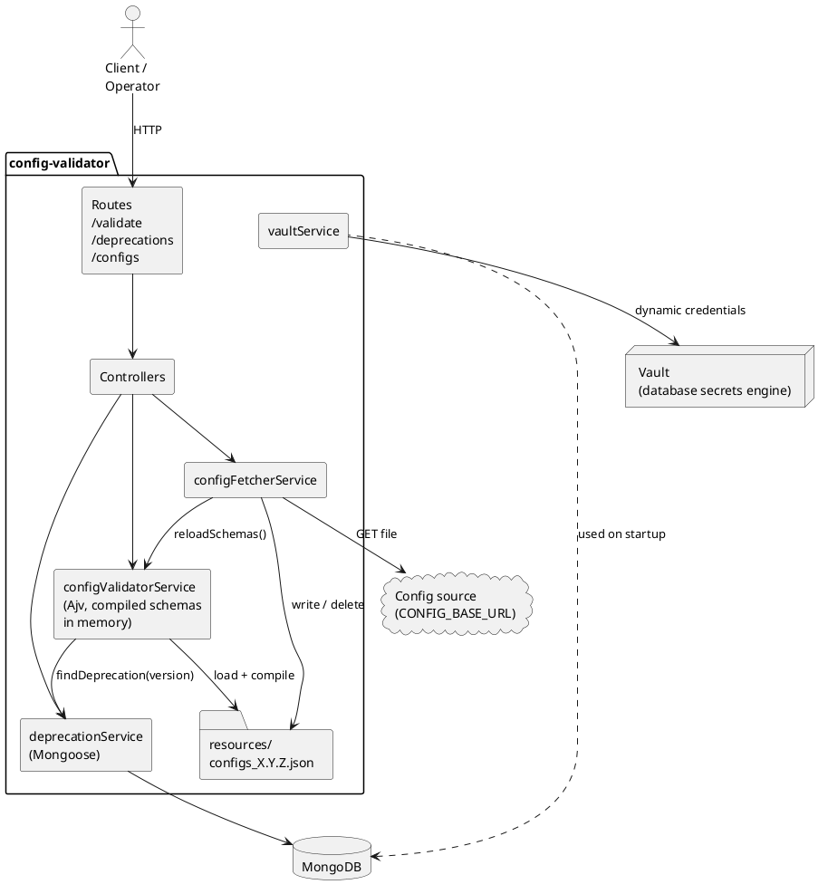
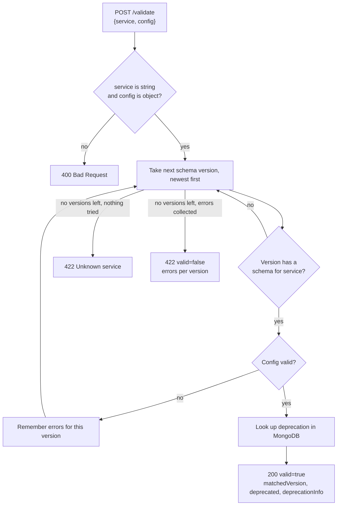
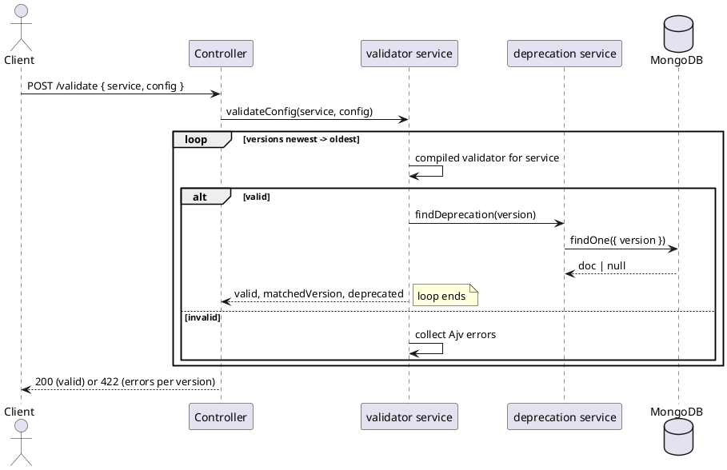
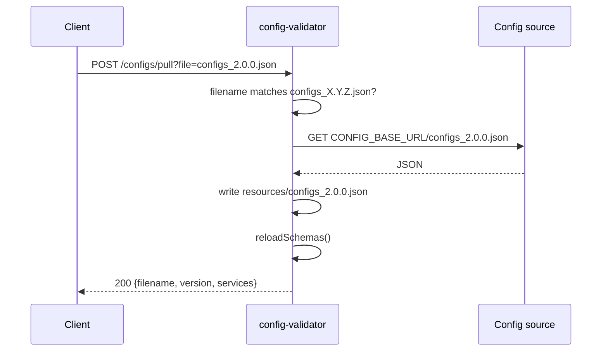
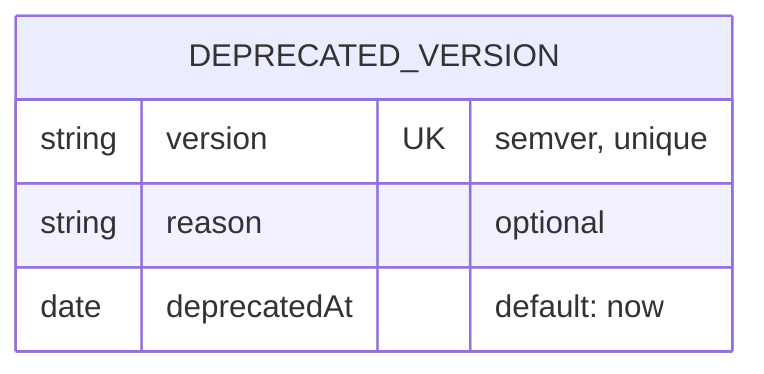
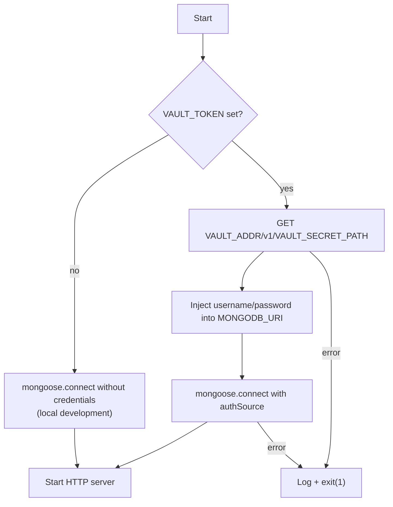

Config Validator is a TypeScript/Express service that validates a service configuration against **versioned JSON schemas**. Schema versions can be marked as _deprecated_, so clients learn that their config only matches an outdated schema.

Source: [project-lex/config-validator](https://github.com/project-lex/config-validator)

## Responsibilities

- Hold one schema file per version (`configs_<semver>.json`), each mapping a service name to a JSON Schema.
- Validate a posted config against all versions of a service, newest first, using [Ajv](https://ajv.js.org/).
- Report which version matched and whether that version is deprecated.
- Persist the deprecation state in MongoDB so it survives restarts.
- Pull new schema files from a remote location (`CONFIG_BASE_URL`) at runtime.
- Get dynamic MongoDB credentials from HashiCorp Vault.

## Architecture



### Code layout

| Path                                    | Purpose                                                       |
| --------------------------------------- | ------------------------------------------------------------- |
| `src/server.ts`                         | Connects to MongoDB, then starts the HTTP server              |
| `src/app.ts`                            | Express setup and route mounting                              |
| `src/config/config.ts`                  | Typed environment configuration                               |
| `src/routes/`, `src/controllers/`       | HTTP layer for validation, deprecations and schema management |
| `src/services/configValidatorService.ts`| Loads/compiles schemas, runs the version-by-version validation|
| `src/services/deprecationService.ts`    | CRUD for deprecated versions                                  |
| `src/services/configFetcherService.ts`  | Downloads/deletes schema files, triggers a reload             |
| `src/models/deprecatedVersion.ts`       | Mongoose model                                                |
| `src/vault/vaultService.ts`             | Reads dynamic DB credentials from Vault                       |
| `resources/`                            | Schema files, one per version                                 |

## Schema files

Files are named `configs_<major>.<minor>.<patch>.json` and map a service name to a JSON Schema (draft-07):

```json
{
  "foo": {
    "$schema": "http://json-schema.org/draft-07/schema#",
    "type": "object",
    "properties": {
      "host": { "type": "string" },
      "port": { "type": "integer", "minimum": 1, "maximum": 65535 },
      "tls":  { "type": "boolean" }
    },
    "required": ["host", "port", "tls"],
    "additionalProperties": false
  }
}
```

All schemas are compiled once at startup and again whenever `reloadSchemas()` runs (after a pull or a purge). They are sorted by semver, newest first.

## Validation algorithm



Consequences worth knowing:

- The **first** matching version wins. A config can therefore be valid for an old version while failing the newest one, which is exactly the case the deprecation flag is meant for.
- A service that does not exist in any version yields `422` with the key `(all versions)`.
- If MongoDB is not reachable during the deprecation lookup, the check is skipped silently and the response says `deprecated: false`.

### Sequence



## API

| Method   | Path                           | Description                                                  | Success | Errors                |
| -------- | ------------------------------ | ------------------------------------------------------------ | ------- | --------------------- |
| `POST`   | `/validate`                    | Validate a config                                            | `200`   | `400`, `422`          |
| `GET`    | `/deprecations`                | List deprecated versions                                     | `200`   |                       |
| `POST`   | `/deprecations`                | Mark a version as deprecated                                 | `201`   | `400`, `409`          |
| `DELETE` | `/deprecations/:version`       | Remove a deprecation                                         | `204`   | `404`                 |
| `POST`   | `/configs/pull?file=<name>`    | Download a schema file from `CONFIG_BASE_URL` and reload     | `200`   | `400`, `500`, `502`   |
| `DELETE` | `/configs`                     | Delete all local schema files and reload (empty)             | `200`   |                       |

### `POST /validate`

Request:

```json
{ "service": "foo", "config": { "host": "db.example.com", "port": 5432, "tls": true } }
```

Valid, current version:

```json
{ "valid": true, "service": "foo", "matchedVersion": "2.0.0", "deprecated": false }
```

Valid, but matched a deprecated version:

```json
{
  "valid": true,
  "service": "foo",
  "matchedVersion": "1.0.0",
  "deprecated": true,
  "deprecationInfo": { "reason": "Use version 2.0.0 instead", "deprecatedAt": "2026-05-08T10:00:00.000Z" }
}
```

Invalid (`422`), with the errors of every tried version:

```json
{
  "valid": false,
  "service": "foo",
  "errors": {
    "2.0.0": ["(root) must have required property 'tls'"],
    "1.0.0": ["/port must be <= 65535"]
  }
}
```

Malformed requests return `400` with `{"message": "Missing or invalid \"service\" field"}` or `{"message": "Missing or invalid \"config\" field — must be an object"}`.

### Deprecations

```bash
curl -X POST localhost:3000/deprecations -H 'Content-Type: application/json' \
     -d '{"version":"1.0.0","reason":"Use 2.0.0 instead"}'
curl localhost:3000/deprecations
curl -X DELETE localhost:3000/deprecations/1.0.0
```

### Pulling schemas

`POST /configs/pull?file=configs_2.0.0.json` downloads `<CONFIG_BASE_URL>/configs_2.0.0.json`, checks that it is valid JSON, writes it to `resources/` and reloads all validators immediately.



| Status | Cause                                                          |
| ------ | -------------------------------------------------------------- |
| `400`  | `file` missing or not matching `configs_X.Y.Z.json`            |
| `500`  | `CONFIG_BASE_URL` not configured                               |
| `502`  | Source unreachable, non-2xx answer, or invalid JSON            |

## Data model



Stored in the collection `MONGODB_COLLECTION` (default `config-deprecations`).

## Configuration

| Variable              | Default                        | Description                                                             |
| --------------------- | ------------------------------ | ----------------------------------------------------------------------- |
| `PORT`                | `3000`                         | HTTP port                                                               |
| `NODE_ENV`            | `development`                  | Runtime environment                                                     |
| `CONFIG_BASE_URL`     |                                | Base URL for `POST /configs/pull`                                       |
| `VAULT_ADDR`          | `http://vault:8200`            | Vault address                                                           |
| `VAULT_TOKEN`         |                                | Vault token. **Empty = skip Vault** and connect to MongoDB without auth |
| `VAULT_NAMESPACE`     |                                | Vault namespace                                                         |
| `VAULT_SECRET_PATH`   | `database/creds/mongodb-role`  | Path of the dynamic MongoDB credentials                                 |
| `MONGODB_URI`         | `mongodb://localhost:27017`    | MongoDB URI, without credentials                                        |
| `MONGODB_DB`          | `project-lex`                  | Database name                                                           |
| `MONGODB_COLLECTION`  | `config-deprecations`          | Collection for deprecations                                             |
| `MONGODB_AUTH_SOURCE` | `project-lex`                  | `authSource` for the Vault-created user                                 |

### Startup and credentials



The service does not start if the database connection fails.

## Running

```bash
cp .env.example .env
npm install
npm run dev        # development
npm run build && npm start
npm test           # Jest
```

```bash
docker build -t config-validator .
docker run -p 3000:3000 --env-file .env config-validator
```

The Docker image contains the `resources/` folder from the build. A GitHub Actions workflow builds a multi-arch image (`linux/amd64`, `linux/arm64`) on every push to `main` and pushes it to `ghcr.io/project-lex/config-validator` with the tags `latest` and the commit SHA.

## Known limitations

- **No authentication** on any endpoint, including `DELETE /configs` and the deprecation routes.
- Schema files pulled at runtime are written into the container filesystem and are **lost when the container is replaced**. Only the files baked into the image survive.
- Vault credentials are dynamic (they have a lease), but they are fetched only once at startup and never renewed. After the lease expires, new MongoDB connections will fail.
- The deprecation lookup swallows MongoDB errors, so an outage looks like "not deprecated".
- The repository still contains unused template code (`itemController`, `itemRoutes`, `models/item.ts`); these routes are not mounted.
- The README's environment table (`MONGODB_HOST`, `MONGODB_PORT`, `MONGODB_DATABASE`) does not match the code (`MONGODB_URI`, `MONGODB_DB`, `MONGODB_COLLECTION`, `MONGODB_AUTH_SOURCE`). The table above follows the code.
- `PORT` defaults to `3000` in code but `.env.example` uses `3001`.
- The `Dockerfile` installs dev dependencies in the runtime image.
