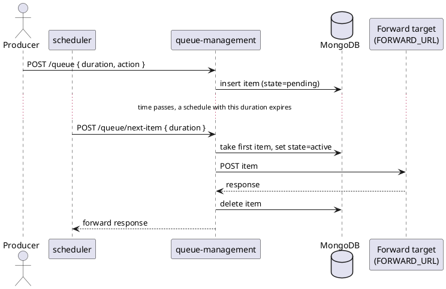
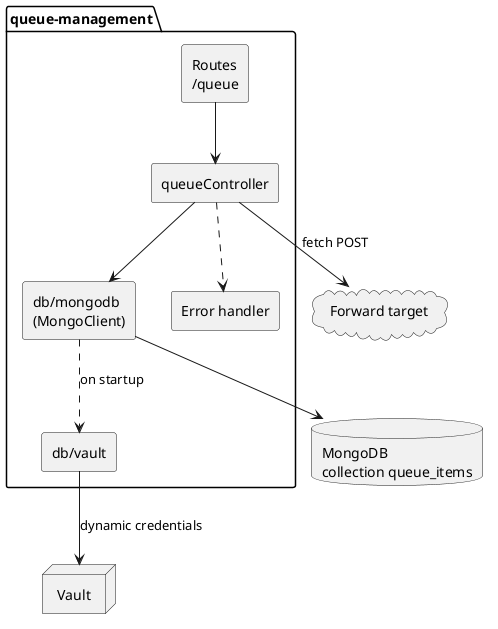
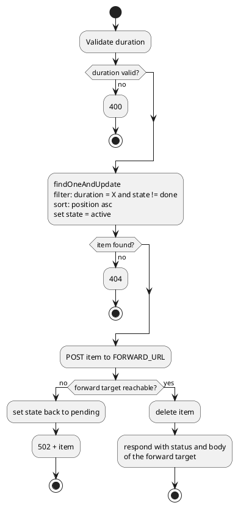
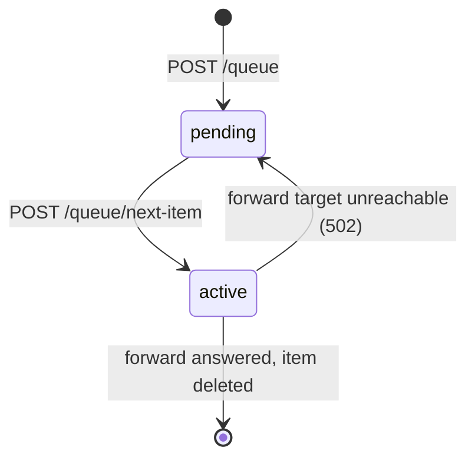
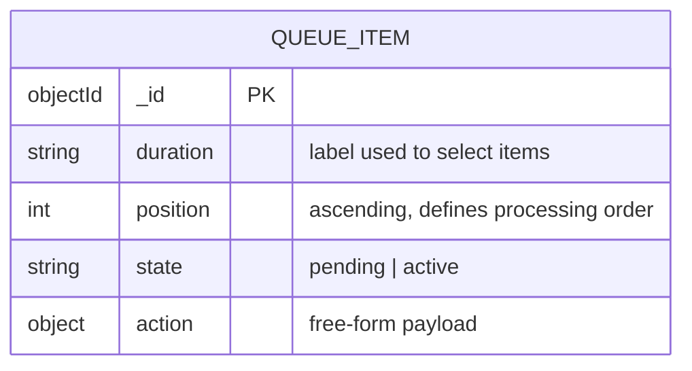

# Que Management

Queue Management (repository `queue-management`) holds work items in a queue in MongoDB. Items are ordered by position. When the [scheduler](./scheduler.md) asks for the next item of a given _duration_, the service forwards the item to a configurable target service and removes it from the queue.

Source: [project-lex/queue-management](https://github.com/project-lex/queue-management)

## Responsibilities

- Accept new queue items (`duration` + free-form `action`) and assign the next position.
- List all items ordered by position.
- On request, take the first item for a duration, forward it to `FORWARD_URL` and delete it.
- Give the item back to the queue if the forward target is unreachable.

## Place in the system



The scheduler's webhook body (`{"name": "...", "duration": "..."}`) already contains the `duration` field, so `WEBHOOK_URL` of the scheduler can point directly at `POST /queue/next-item`. Check the deployment configuration for how it is wired in your environment.

## Architecture



| Path                                | Purpose                                                  |
| ----------------------------------- | -------------------------------------------------------- |
| `src/server.ts`                     | Connects to MongoDB (needs Vault first), starts HTTP     |
| `src/app.ts`                        | Express setup, mounts `/queue`                            |
| `src/routes/queueRouter.ts`         | Queue routes                                              |
| `src/controllers/queueController.ts`| Create, list and forward logic                            |
| `src/models/queue.ts`               | `QueueItem` type                                          |
| `src/db/mongodb.ts`, `src/db/vault.ts` | Connection and Vault credentials                       |
| `src/config/config.ts`              | Environment configuration                                 |

## API

| Method | Path               | Description                                                       | Success       | Errors               |
| ------ | ------------------ | ----------------------------------------------------------------- | ------------- | -------------------- |
| `GET`  | `/queue`           | All items, sorted by `position`                                   | `200`         |                      |
| `POST` | `/queue`           | Create an item; position = last position + 1                      | `201`         | `400`                |
| `POST` | `/queue/next-item` | Forward and remove the next item for a duration                   | forward status| `400`, `404`, `502`  |

### `POST /queue`

```json
{ "duration": "30min", "action": { "type": "notify", "payload": "..." } }
```

- `duration` must be a non-empty string; it is only used as a label that `next-item` matches exactly (`"30min"` ≠ `"30m"`).
- `action` must be an object (no array, no `null`).

Response `201`:

```json
{ "_id": "…", "duration": "30min", "action": { "type": "notify" }, "position": 3, "state": "pending" }
```

### `POST /queue/next-item`

```json
{ "duration": "30min" }
```



## Item lifecycle



The `QueueItem` type also lists a `done` state, but items are deleted instead of being marked `done`, so it never occurs.

## Data model

Collection `queue_items` (hard-coded name):



## Configuration

| Variable              | Default                        | Description                                           |
| --------------------- | ------------------------------ | ----------------------------------------------------- |
| `PORT`                | `3000`                         | HTTP port                                             |
| `NODE_ENV`            | `development`                  | Runtime environment                                   |
| `FORWARD_URL`         | `http://localhost:3001`        | Target that receives the forwarded item (`POST`)      |
| `MONGODB_URI`         | `mongodb://mongodb.localhost`  | Must start with `mongodb://`; credentials are injected|
| `MONGODB_DB`          | `project-lex`                  | Database name                                         |
| `MONGODB_COLLECTION`  | `queue`                        | Fallback only; the queue uses `queue_items`           |
| `MONGODB_AUTH_SOURCE` | `project-lex`                  | `authSource` for the Vault user                       |
| `VAULT_ADDR`          | `http://vault`                 | Vault address                                         |
| `VAULT_TOKEN`         |                                | Vault token (**required**, there is no Vault-less mode)|
| `VAULT_NAMESPACE`     |                                | Optional namespace                                    |
| `VAULT_SECRET_PATH`   | `database/creds/mongodb-role`  | Path with `username` and `password`                   |

## Running

```bash
cp .env.example .env
npm install
npm run dev
npm test
```

```bash
docker build -t queue-management .
docker run -p 3000:3000 --env-file .env queue-management
```

Every push to `main` builds a multi-arch image and pushes it to `ghcr.io/project-lex/queue-management` (`latest` and commit SHA).

## Known limitations

- **Double delivery is possible.** `next-item` selects `state != done`, which also matches items that are already `active`. Two concurrent calls (or a call during an ongoing forward) pick the same first item and forward it twice. The filter should be `state: 'pending'`.
- The item is deleted after the forward target answered, **regardless of its HTTP status**. A `500` from the target loses the item. Only a network failure puts it back to `pending`.
- If the process crashes while an item is `active`, it stays `active` forever.
- `POST /queue` calculates the position with a read followed by an insert, so concurrent creates can get the same position.
- Vault credentials are read once at startup and not renewed.
- No authentication on any endpoint.
- Unused template code remains in the repo (`itemController`, `itemRoutes`, `models/item.ts`); these routes are not mounted.
- The `Dockerfile` installs dev dependencies in the runtime image.
