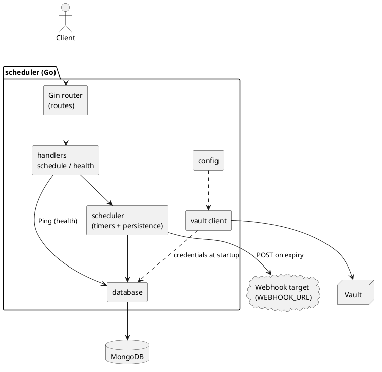
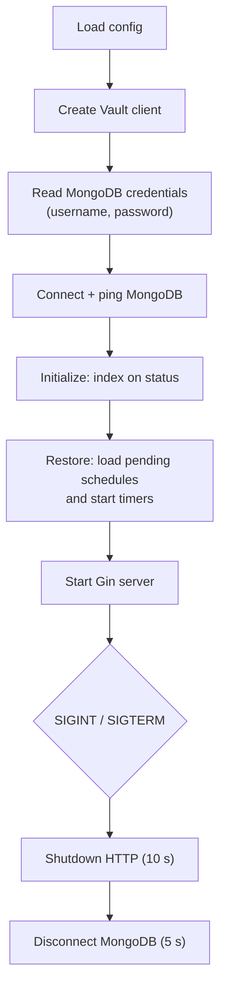
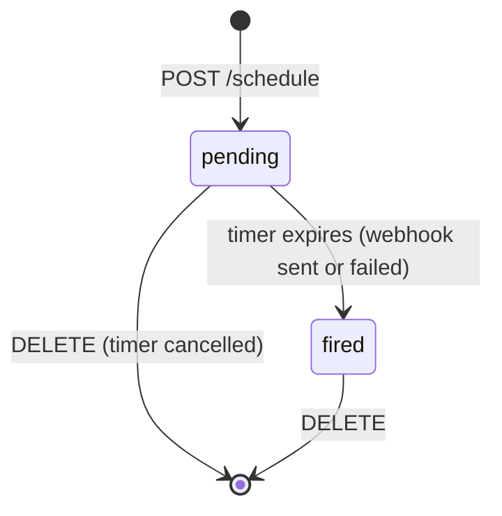
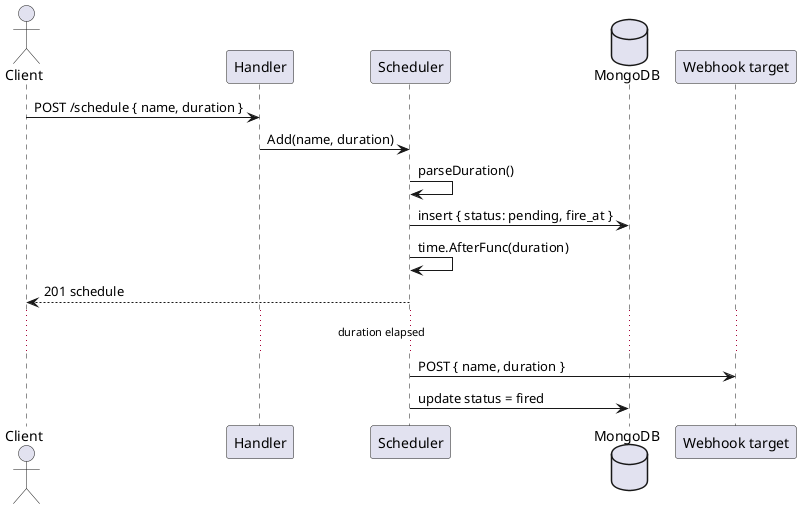
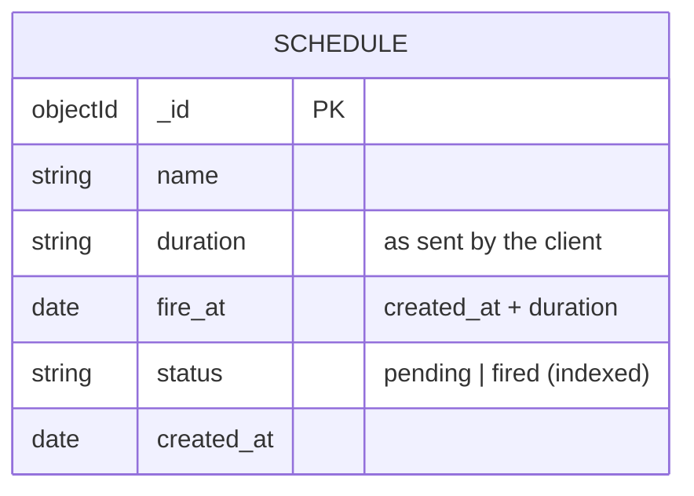

The scheduler is a Go service (Gin + MongoDB) that runs one-shot timers. A schedule consists of a `name` and a `duration`. When the duration has elapsed, the scheduler sends a webhook request and marks the schedule as `fired`. Schedules are stored in MongoDB and restored after a restart.

Source: [project-lex/scheduler](https://github.com/project-lex/scheduler)

## Responsibilities

- Create, list and delete schedules via a REST API.
- Keep an in-memory timer for every pending schedule.
- Fire a webhook when a timer expires.
- Persist schedules, and re-arm pending timers on startup.
- Provide a health endpoint that checks MongoDB.
- Fetch the MongoDB credentials from HashiCorp Vault.

## Architecture



### Code layout

| Path                              | Purpose                                                    |
| --------------------------------- | ---------------------------------------------------------- |
| `main.go`                         | Wiring, startup sequence, graceful shutdown                |
| `config/config.go`                | Reads environment variables                                |
| `internal/vault/vault.go`         | Vault client, reads `username` and `password`              |
| `internal/database/mongodb.go`    | Connects, pings, applies credentials                       |
| `internal/scheduler/scheduler.go` | Timer map, persistence, webhook, duration parsing          |
| `internal/models/schedule.go`     | `Schedule` model                                           |
| `internal/handlers/`              | HTTP handlers (`health`, `schedule`)                       |
| `internal/routes/routes.go`       | Route registration                                         |

## Startup and shutdown



A failing Vault read, MongoDB connection or index creation aborts the start. A failing _restore_ only logs a warning and the service keeps running with no restored timers.

## Schedule lifecycle



`fire_at = created_at + duration`. After a restart, overdue schedules fire immediately (delay is clamped to `0`).



## API

| Method   | Path                  | Description                              | Success | Errors       |
| -------- | --------------------- | ---------------------------------------- | ------- | ------------ |
| `GET`    | `/health`             | Pings MongoDB                            | `200`   | `503`        |
| `GET`    | `/schedule`           | List all schedules                       | `200`   | `500`        |
| `POST`   | `/schedule`           | Create a schedule                        | `201`   | `400`        |
| `DELETE` | `/schedule?id=<id>`   | Delete one schedule, cancel its timer    | `204`   | `400`, `404` |
| `DELETE` | `/schedule?all`       | Delete all schedules, cancel all timers  | `200` `{"deleted": N}` | `500` |

```bash
curl http://localhost:8080/health
curl -X POST http://localhost:8080/schedule \
     -H 'Content-Type: application/json' \
     -d '{"name": "my-job", "duration": "10m"}'
curl http://localhost:8080/schedule
curl -X DELETE "http://localhost:8080/schedule?id=69fdd111db98d88593e32032"
curl -X DELETE "http://localhost:8080/schedule?all"
```

`name` and `duration` are required. Errors are returned as `{"error": "..."}`.

### Durations

`duration` accepts Go duration strings (`10m`, `1h30m`, `90s`) and a few aliases that are rewritten first: `min`, `minute(s)`, `sec`, `second(s)`, `hour(s)`, `hr`. Days or weeks are not supported.

### Webhook

When a timer expires, the scheduler sends:

```http
POST <WEBHOOK_URL>
Content-Type: application/json

{"name": "my-job", "duration": "10m"}
```

Any `2xx` is success. Other answers or network errors are only logged. There is no retry. If `WEBHOOK_URL` is empty, the call is skipped.

### Schedule document



## Configuration

| Variable            | Default                           | Description                                                          |
| ------------------- | --------------------------------- | -------------------------------------------------------------------- |
| `PORT`              | `8080`                            | HTTP port                                                            |
| `VAULT_ADDR`        | `http://127.0.0.1:8200`           | Vault address                                                        |
| `VAULT_TOKEN`       |                                   | Vault token (dev only, prefer AppRole/Kubernetes auth in production) |
| `VAULT_SECRET_PATH` | `secret/data/scheduler/mongodb`   | Secret that holds `username` and `password`                          |
| `MONGO_URI`         | `mongodb://localhost:27017`       | MongoDB URI, without credentials                                     |
| `MONGO_DATABASE`    | `project-lex`                     | Database name                                                        |
| `MONGO_COLLECTION`  | `schedules`                       | Collection name                                                      |
| `MONGO_AUTH_SOURCE` | `admin`                           | Database where the (Vault-created) user is defined                   |
| `WEBHOOK_URL`       |                                   | Target of the expiry webhook                                         |

In the deployment, `.env.example` sets `VAULT_SECRET_PATH=database/creds/mongodb-role` (Vault database secrets engine) and `MONGO_AUTH_SOURCE=project-lex`.

!!! warning "Vault secret format"
    The code reads the keys `username` and `password` directly from `secret.Data`. This matches the database secrets engine (`database/creds/...`). A KV v2 secret nests its values under `data.data` and would not be found. The `uri` key mentioned in the README is not read.

## Running

Requirements: Go 1.22+, a reachable Vault and MongoDB.

```bash
cp .env.example .env
make run
```

| Target             | Description                       |
| ------------------ | --------------------------------- |
| `make build`       | Compile to `bin/scheduler`        |
| `make run`         | Run with the variables from `.env`|
| `make test`        | `go test ./...`                   |
| `make lint`        | `golangci-lint run`               |
| `make docker-build`| Build the image                   |
| `make docker-run`  | Run the image with `.env`         |

The image is built in two stages: `golang:1.22-alpine` compiles a static binary, the runtime image is `gcr.io/distroless/static-debian12:nonroot` (no shell, non-root user). Every push to `main` builds and pushes it to GHCR (`latest` and the short commit SHA), using the built-in `GITHUB_TOKEN`.

## Known limitations

- **Single instance only.** Timers live in process memory and every instance restores all pending schedules, so running two replicas fires every schedule twice.
- A schedule is set to `fired` even if the webhook failed. There is no retry and no failed state.
- Fired schedules stay in MongoDB until they are deleted manually.
- Vault credentials are read once at startup and not renewed.
- No authentication on any endpoint, including `DELETE /schedule?all`.
- The README is partly outdated: it documents `scheduler/mongodb` as secret path, the `uri` secret key and `scheduler` as default database. The table above follows the code.
- `routes.go` contains an empty `/api/v1` group, so no versioned API exists yet.
