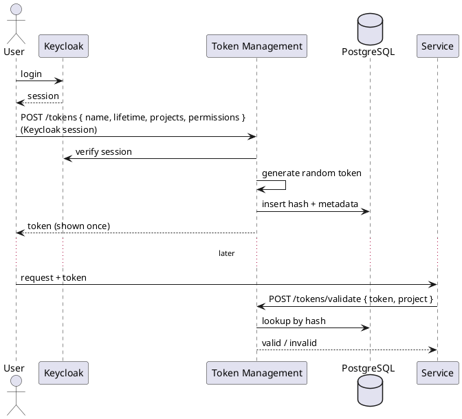
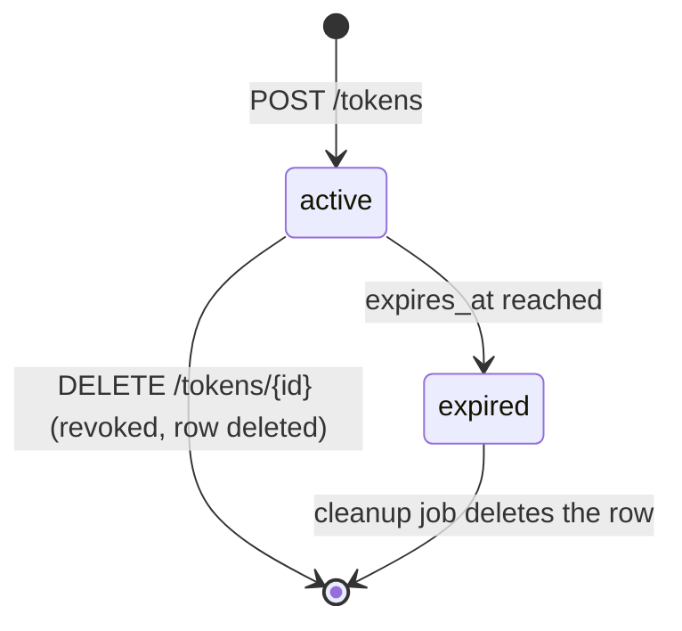
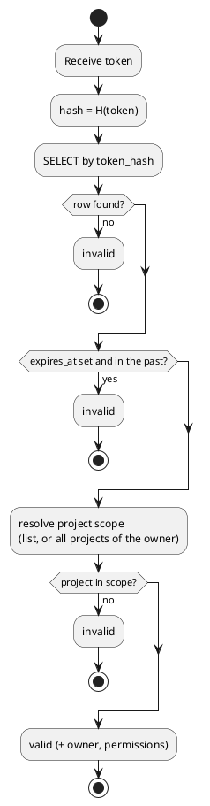
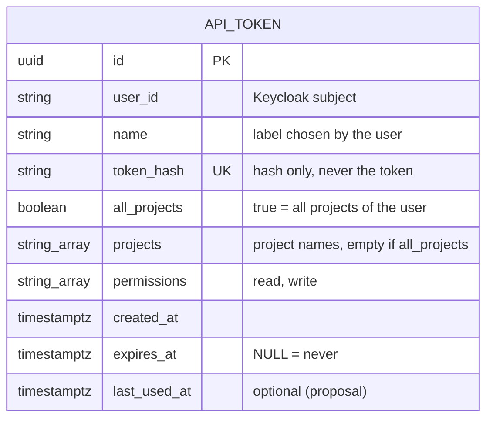

# Token Management

!!! info "Planned service"
    Token Management is **not implemented yet**. This page describes the agreed design. Details marked _(proposal)_ are not decided yet. Once the code exists, this page should be checked against it.

Token Management issues, validates and revokes API tokens. A user logs in via Keycloak and requests a token with that session. Services (or the gateway in front of them) send the token to Token Management to find out whether it is valid.

## Responsibilities

- Hand out API tokens to authenticated users.
- Validate tokens on request of other services.
- Revoke tokens; a revoked token is invalid immediately.
- Store only a hash of each token in PostgreSQL.
- Support configurable lifetimes, including tokens that never expire.

## Place in the system



## Token design

- **Opaque.** The token is a random string with no embedded data (not a JWT). All information lives in the database.
- **Shown once.** The plain token is returned only when it is created. Afterwards only its hash exists, so it cannot be recovered; a lost token must be replaced.
- **Hashed storage.** Only a hash is stored in PostgreSQL. Because the tokens are long and random, a fast hash such as SHA-256 is sufficient _(proposal)_; no salt or slow password hash is needed.
- **Random source.** Generate at least 256 bits from a cryptographically secure random generator _(proposal)_. A readable prefix (for example `lex_`) helps secret scanners and users recognise it _(proposal)_.

### Lifetime

The user chooses the lifetime when creating the token.

| Option      | `expires_at`            |
| ----------- | ----------------------- |
| never       | `NULL`                  |
| 7 days      | now + 7 days            |
| 30 days     | now + 30 days           |
| 2 months    | now + 2 months          |
| 3 months    | now + 3 months          |
| custom      | date/duration from user |

There is no limit on the number of tokens per user. Every user may create every lifetime option, including `never`.

### Scopes

A token carries a scope that is fixed when it is created:

- **Projects:** a list of project names (array of strings), or _all projects of the user_.
- **Permissions:** `read`, `write`, or both.

| Example                                        | Meaning                                                |
| ---------------------------------------------- | ------------------------------------------------------ |
| projects `["lex", "demo"]`, permissions `read` | Read access to the projects `lex` and `demo` only      |
| projects `all`, permissions `read`, `write`    | Read and write in every project the user has access to |

"All" is resolved at validation time, not at creation. It always means the projects the user can access right now, so removing a user from a project also removes the token's access to it. A token never grants more than its owner has.

## Token lifecycle



### Cleanup job

A scheduled job deletes rows whose `expires_at` is in the past. Validation already rejects expired tokens, so the job only keeps the table small and does not affect correctness. The job can be triggered by the [scheduler](./scheduler.md) or run inside the service; the interval is configurable.

Revocation **deletes the row**. Since every validation reads the database, a deleted token is rejected on the very next request. There is no cache that could keep it alive, and this must stay true if caching is added later (no positive caching, or only with a very short TTL).

## Validation

Token Management validates the tokens it issued itself; other services do not need to know the hash or the database.



The lookup by hash should use a unique index and, ideally, a constant-time comparison. The response must not reveal whether a token never existed, was revoked or expired.

## API _(proposal)_

| Method   | Path               | Auth             | Description                                  | Success | Errors             |
| -------- | ------------------ | ---------------- | -------------------------------------------- | ------- | ------------------ |
| `POST`   | `/tokens`          | Keycloak session | Create a token; plain token only in response | `201`   | `400`, `401`       |
| `GET`    | `/tokens`          | Keycloak session | List own tokens (metadata, never the token)  | `200`   | `401`              |
| `DELETE` | `/tokens/{id}`     | Keycloak session | Revoke one own token                         | `204`   | `401`, `404`       |
| `POST`   | `/tokens/validate` | service call     | Check a token                                | `200`   | `400`, `401`       |

### `POST /tokens`

```json
{
  "name": "ci-pipeline",
  "lifetime": "30d",
  "projects": ["lex", "demo"],
  "permissions": ["read", "write"]
}
```

- `projects` is an array of project names, or the string `"all"` for all projects of the user.
- `permissions` contains `read`, `write` or both.
- `lifetime` is `never`, `7d`, `30d`, `2m`, `3m`, or a custom value (date or duration).

Response `201`:

```json
{
  "id": "5b0c…",
  "name": "ci-pipeline",
  "token": "lex_…",
  "projects": ["lex", "demo"],
  "permissions": ["read", "write"],
  "expires_at": "2026-12-26T10:00:00Z"
}
```

### `POST /tokens/validate`

The caller sends the token together with the project it is used for.

```json
{ "token": "lex_…", "project": "lex" }
```

Response `200`:

```json
{
  "valid": true,
  "user_id": "…",
  "token_id": "5b0c…",
  "permissions": ["read"],
  "expires_at": null
}
```

or `{ "valid": false }`. `valid` is `false` if the token is unknown, revoked, expired, or does not cover the given project. The caller then decides whether the returned `permissions` allow the requested action (`read` for reads, `write` for changes). It is open whether an invalid token returns `200` with `valid: false` or `401`. How callers of `/tokens/validate` authenticate themselves (network trust, service token, mTLS) is not decided yet.

## Data model



Unique index on `token_hash`, index on `user_id`.

## Dependencies

| Dependency | Purpose                                                    |
| ---------- | ---------------------------------------------------------- |
| Keycloak   | Authenticates the user that creates, lists or revokes tokens |
| PostgreSQL | Stores token hashes and metadata                           |
| Vault      | Database credentials, like the other services _(proposal)_ |

This is the first project-lex service that uses PostgreSQL; the other services use MongoDB.

## Security notes

- Never log tokens, neither in requests nor in errors.
- Rate-limit `/tokens/validate` to slow down guessing _(proposal)_.
- A token never grants more than its owner has; scopes only narrow the rights.
- Tokens that never expire are convenient but risky. Show `last_used_at` and encourage rotation.

## Deployment

Token Management is deployed like every other project-lex service:

- Own repository in the `project-lex` organization, built into a Docker image on every push to `main` and pushed to `ghcr.io/project-lex/token-management` (`latest` and commit SHA).
- Entry in the `structure` repository's `docker-compose.yaml`, configured through environment variables in `.env`.
- Database credentials come from Vault at startup (see [shared startup pattern](../overview.md#shared-startup-pattern)). For PostgreSQL this needs a database secrets engine role for Postgres next to the existing MongoDB role.
- Keycloak address and realm are configured through environment variables.

## Open questions

- How do services authenticate against `/tokens/validate`?
- Does an invalid token return `200` with `valid: false` or `401`?
- Programming language and exact configuration variables.
